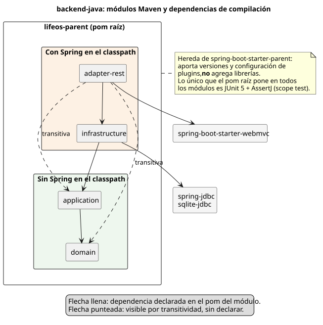

> [!CAUTION]
> **DEPRECATED. DO NOT USE THIS FILE AS A GUIDE.**
> This is the old Life OS codebase, frozen on 2026-10-24. It was built
> with known bad practices: a Java backend written as a partial clone of the
> Python one, two implementations sharing one database, and decisions
> (ADRs included) that grew out of early design errors. Nothing here is a
> requirement or a constraint for new work, and its rules do not apply.
> Read it only to look up a pattern, never to copy a decision.
> Active development lives in [`new/`](../../../new/README.md). Details in
> [`deprecated/DEPRECATED.md`](../../DEPRECATED.md).

# 00 — Panorama

Lección de orientación: qué es `backend-java/`, con quién convive y cómo está
cortado en módulos. Las capas se ven en detalle en las lecciones siguientes;
acá alcanza con saber dónde está cada cosa y por qué está así.

## Qué resuelve

`backend-java/` expone Projects y Tasks por HTTP (REST + JSON). Lo consume la
web (`frontend/`, React + Vite), que **el mismo jar sirve en `/app/`**. ADR 0011
menciona además un cliente Android, que no está en este repo.

Es un port a Java + Spring Boot del backend Python, todavía a medio camino
([ADR 0011](../adr/0011-java-spring-backend.md)). Ese dato explica casi todas
las rarezas que van a aparecer.

## Dos backends, una base

| | Python (`backend/`) | Java (`backend-java/`) |
|---|---|---|
| Sirve a | board de escritorio (`lifeos-daemon`), MCP, CLI, TUI | web (`/app/`) |
| Rutas propias | `/revision`, `/quick-add` | — |
| REST de Projects/Tasks | sí | sí, con el mismo contrato: rutas, JSON en snake_case, códigos de estado y de error |
| Local (`docker-compose.yml`) | puerto 8000 | puerto 8001 |
| VPS (`deploy/vps/`) | apagado | `127.0.0.1:8000`, detrás de Caddy en 443 |

Los dos leen y escriben **la misma base SQLite**:

- En el escritorio es `~/.local/share/life-os/lifeos.db` (XDG; `DATABASE_URL`
  la pisa, ver [ADR 0007](../adr/0007-shared-database-location.md)).
- En Docker es el volumen `lifeos-data`. Las dos imágenes corren con el mismo
  uid 1000 para que el volumen tenga un solo dueño.

Java no reemplaza a Python para el board: le faltan `/revision` y `/quick-add`.

Que compartan base tiene consecuencias que se ven en la lección 03:

- Java escribe el formato exacto de SQLAlchemy: fechas como texto UTC sin zona
  con microsegundos, enums en minúscula, UUID como string.
- Java solo toca las columnas que conoce (listas explícitas de columnas), así
  las que agregue Python sobreviven.
- `StorageFormatTest` fija ese formato con strings literales.
  `PythonInteropTest` hace una ida y vuelta real contra el código Python. Este
  último corre en CI (job `java-test`); en local solo corre si se define
  `LIFEOS_PYTHON_BACKEND`.
- Mientras dure la convivencia, cada regla de negocio existe dos veces, una
  por lenguaje.

## Mapa de módulos

Un módulo Maven por capa hexagonal:

| Módulo | Contiene | Depende de |
|---|---|---|
| `domain` | Entidades `Project` y `Task`, sus enums de estado y prioridad, excepciones de dominio | nada |
| `application` | Casos de uso (una clase por acción: `CreateTask`, `MoveTask`, …) y puertos (`ProjectRepository`, `TaskRepository`, filtros) | `domain` |
| `infrastructure` | Implementación SQLite de los puertos, ubicación de la base | `application`, `spring-jdbc`, `sqlite-jdbc` |
| `adapter-rest` | La aplicación Spring Boot: controllers, DTOs, manejo de errores, filtros de seguridad, cableado | `infrastructure`, `spring-boot-starter-webmvc` |

## Qué impone el build y qué no

**Un pom padre no es una dependencia.** El pom raíz hereda de
`spring-boot-starter-parent`, pero eso solo aporta *gestión*: versiones
(`dependencyManagement`) y configuración de plugins. No pone ninguna librería
en el classpath. Lo único que el pom raíz agrega a todos los módulos es JUnit 5
y AssertJ, con scope `test`.

Lo que el build impone:

- `domain` y `application` no tienen Spring en el classpath. Un
  `import org.springframework...` ahí no compila.
- `domain` no ve a ningún otro módulo; `application` solo ve a `domain`.
- La flecha no se puede invertir. Si `application` declarara una dependencia a
  `infrastructure`, Maven rechazaría el build por referencia cíclica, porque
  `infrastructure` ya depende de `application`.

Lo que el build **no** impone:

- **Spring llega hasta `infrastructure`.** Usa `JdbcClient` de `spring-jdbc`
  (no Spring Boot). Es una elección deliberada del ADR 0011, pero la frase
  "libre de frameworks" vale solo para `domain` y `application`.
- **Nada obliga a los controllers a pasar por los casos de uso.**
  `adapter-rest` ve `infrastructure` directo, y `application` y `domain` por
  transitividad. Un controller podría importar `SqliteTaskRepository` y
  saltearse las reglas de negocio, y compilaría. Hoy no pasa: la única clase
  de `adapter-rest` que importa `lifeos.infrastructure` es
  `WiringConfiguration`. Pero eso es disciplina y revisión de código, no el
  compilador. Un test de arquitectura (por ejemplo ArchUnit) lo volvería una
  regla verificable.
- **Dependencias sin declarar.** `adapter-rest` usa clases de `domain` y
  `application` sin declararlas en su pom; funciona porque llegan por
  transitividad.

## Cómo arranca

1. `LifeOsApplication` tiene `@SpringBootApplication`, así que Spring escanea
   el paquete `lifeos.adapters.rest`.
2. Ahí encuentra `WiringConfiguration` (`@Configuration`). Sus métodos `@Bean`
   construyen, en orden de dependencia:
   - el `DataSource`, después de resolver la ruta de la base y crear el
     esquema si falta;
   - el `JdbcClient`;
   - los dos repositorios SQLite;
   - los 19 casos de uso, cada uno con `new`.
3. Los controllers reciben los casos de uso por constructor.

`WiringConfiguration` es la **composition root**: el único lugar donde la
implementación concreta se conecta a las abstracciones. Los casos de uso no
llevan `@Service` ni ninguna anotación; Spring los registra porque esta clase
se los entrega ya construidos. Detalle en la lección 04.

La configuración vive en `adapter-rest/src/main/resources/application.properties`:

- puerto 8000;
- JSON en snake_case, para respetar el contrato de Python;
- escucha en loopback por defecto;
- variables de la guardia: `LIFEOS_API_AUTH`, `LIFEOS_API_TOKEN` y
  `LIFEOS_ALLOWED_HOSTS`.

Un detalle de seguridad en los tests: su `application.properties` apunta la
base a una ruta inutilizable bajo `/proc`. Un test que se olvide de configurar
su propia base falla al arrancar en vez de abrir la base real.

## Cómo se construye y se prueba

- **`./mvnw`:** el wrapper de Maven, que fija la versión 3.9.16. `./mvnw verify`
  compila y corre todos los tests.
- **Perfil `web` (`-Pweb`):** construye el frontend con Node y lo mete en el
  jar bajo `static/app/`. Sin el perfil, el jar sale sin interfaz y sin avisar.
  Por eso CI tiene un job (`web-jar`) que verifica que el `index.html` esté
  adentro.
- **`backend-java/Dockerfile`:** tres etapas.
  1. Node construye la web.
  2. El JDK arma el jar.
  3. Solo el JRE lo corre, con usuario no-root.

## Decisiones y por qué

- **Un módulo Maven por capa, no paquetes dentro de un módulo.** Con paquetes,
  la regla de dependencias depende de la buena voluntad; con módulos, la
  verifica el compilador (ADR 0011).
- **JDBC plano en vez de JPA/Hibernate.** Hibernate no tiene dialecto SQLite
  oficial. Las entidades JPA mezclarían persistencia con dominio. Y la
  convivencia con Python exige controlar el formato exacto de cada columna.
- **Sin Flyway (todavía).** Escribiría su tabla de historial en la base
  personal real, cuyo esquema además difiere entre ramas. El esquema se crea de
  forma idempotente, como `create_all` en Python.
- **Mismo contrato que el REST de Python.** Los clientes pueden cambiar de
  backend sin cambiar de URL ni de formato.

## Puntos débiles

Se anotan, no se corrigen durante la revisión.

1. **`test-jar` de `application` sin consumidores.** `application` publica sus
   tests como jar "para que otros módulos reusen los repos fake". El pom raíz
   lo declara en `dependencyManagement`, pero ningún módulo lo usa. Es
   configuración muerta o una intención que quedó a medias.
2. **Estado desactualizado del ADR 0011.** El índice lo marca como
   *Proposed*, pero el backend Java está construido, probado en CI y
   desplegado en el VPS (los ADR 0012 y 0013 lo dan por hecho).
3. **`ARCHITECTURE.md` describe solo Python.** Lo mismo vale para la regla
   "Hexagonal architecture" de `CLAUDE.md` ("pure Python", `fastapi`). Java no
   aparece en la tabla de capas ni en el árbol de carpetas. Hay que integrarlo
   antes de que esto sea documentación oficial.
4. **La frontera adaptador → caso de uso es convención, no regla del build.**
   Ver la sección anterior.
5. **Reglas de negocio duplicadas en dos lenguajes hasta el corte.** Un cambio
   de regla tiene que aterrizar en ambos, y solo el test de interop vigila el
   formato, no el comportamiento.

## Preguntas de repaso

1. El pom raíz hereda de `spring-boot-starter-parent`. ¿Por qué igual
   `domain` no puede importar Spring?
2. Si alguien declara `application → infrastructure`, ¿qué pasa en el build?
3. Un controller importa `SqliteTaskRepository` directamente. ¿Compila? ¿Qué
   regla rompe y quién lo detectaría hoy?
4. ¿Por qué Java guarda las fechas como texto UTC sin zona con microsegundos,
   en vez de lo que sería natural en Java?
5. ¿Por qué el board de escritorio no puede apuntar al backend Java hoy?
6. ¿Dónde se construyen los casos de uso y por qué no llevan `@Service`?
