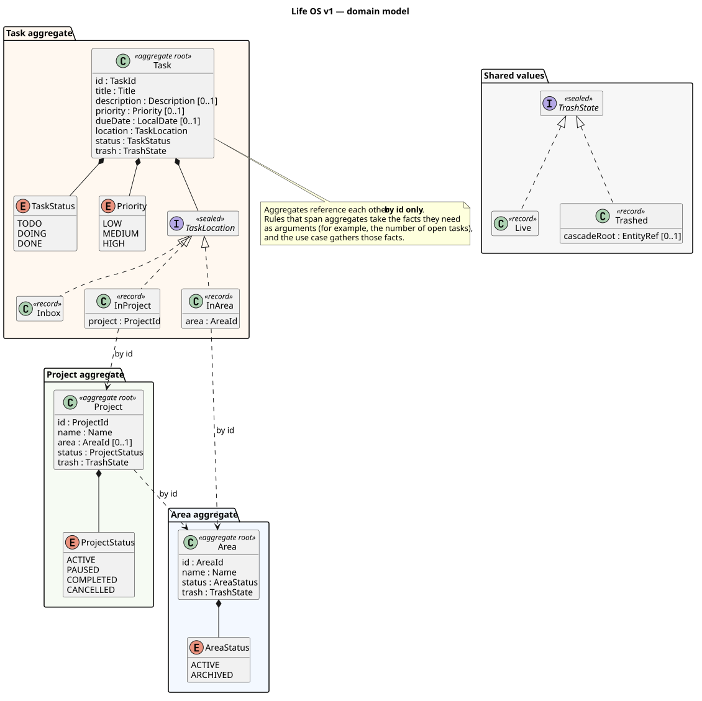

# Domain model — v1

Status: **proposal, under review.** Nothing is implemented yet.

This document defines what Life OS v1 knows about: its concepts, its rules,
and where each rule lives. It is the input for the first implementation
jobs. Persistence, HTTP and the use-case layer are out of its scope.

## Language

These words mean exactly this, in code and in conversation.

| Term | Meaning |
|---|---|
| **Area** | A permanent sphere of life with no end date (Health, Home, Work). It can be archived when it stops mattering. |
| **Project** | An effort with a goal and an end, optionally inside one area. |
| **Task** | A single thing to do. It lives in exactly one place: the inbox, an area, or a project. |
| **Inbox** | Where a task lives when it has not been placed yet. It is a location, not an entity. |
| **Open task** | A task in `TODO` or `DOING` that is not in the trash. |
| **Trash** | Deleted items. They can be restored. Nothing is ever erased in v1. |

## Building blocks

### Identifiers

Each aggregate has its own id type: `AreaId`, `ProjectId` and `TaskId`, each
a record wrapping a `UUID`. The compiler then rejects passing a `TaskId`
where a `ProjectId` is expected, which a bare `UUID` would accept silently.
Factories generate ids with `UUID.randomUUID()`, so the domain needs no
infrastructure to create an entity.

### Value objects

Each one validates itself when constructed, so an invalid one cannot exist.

| Value | Rule |
|---|---|
| `Name` (area, project) | Trimmed, not blank, at most 100 characters. |
| `Title` (task) | Trimmed, not blank, at most 200 characters. |
| `Description` (task) | Optional. Blank text means none. At most 10,000 characters. |
| `Priority` | Optional. `LOW`, `MEDIUM` or `HIGH`. |
| `dueDate` | Optional `LocalDate`. Past dates are allowed, so an overdue task can be entered as such. |

### Task location

`TaskLocation` is a sealed interface with three records: `Inbox`,
`InArea(AreaId)` and `InProject(ProjectId)`.

The alternative is two nullable fields, `areaId` and `projectId`, plus a rule
that at most one is set. A sealed type makes that rule impossible to break.
A `switch` over it must handle all three cases, and the compiler checks that
it does.

### Trash state

`TrashState` is a sealed interface:

- **`Live`:** the item is not in the trash.
- **`Trashed(cascadeRoot)`:** the item is in the trash.
  - With no `cascadeRoot`, the item was trashed on its own.
  - With a `cascadeRoot`, it was dragged into the trash when that container
    (a project or an area) was trashed.

Restoring a container uses that reference to bring back exactly what went
in with it, and nothing that had been trashed separately before.

## Lifecycles

### Task

| From | To | Condition |
|---|---|---|
| any status | any other status | none: transitions are free, and reopening a done task is allowed |

A new task starts in `TODO`.

### Project

| From | To | Condition |
|---|---|---|
| `ACTIVE` | `PAUSED` | — |
| `PAUSED` | `ACTIVE` | — |
| `ACTIVE` or `PAUSED` | `COMPLETED` or `CANCELLED` | the project has no open tasks |
| `COMPLETED` or `CANCELLED` | `ACTIVE` | — (reactivate) |

A new project starts `ACTIVE`. Any transition not in the table is an error,
including moving to the state the project is already in (completing a
completed project). The same holds for areas.

### Area

| From | To | Condition |
|---|---|---|
| `ACTIVE` | `ARCHIVED` | no `ACTIVE` or `PAUSED` live projects in it, and no open tasks directly in it |
| `ARCHIVED` | `ACTIVE` | — |

A new area starts `ACTIVE`.

## Rules

Each rule has an id, so tests and code reviews can point at it.

**Containers**
- **C1.** A task can be created in, or moved to, a project only if the
  project is live and `ACTIVE`. The same applies to an area. The inbox always
  accepts tasks.
- **C2.** A project can be created in, or moved to, an area only if the area
  is live and `ACTIVE`. A project can also have no area.

**Closing**
- **L1.** A project cannot be completed or cancelled while it has open tasks.
- **L2.** An area cannot be archived while it holds `ACTIVE` or `PAUSED` live
  projects, or open tasks directly in it.

**Trash**
- **X1.** Trashing a task trashes only that task.
- **X2.** Trashing a project also trashes its live tasks, with the project as
  their cascade root.
- **X3.** Trashing an area also trashes:
  - its live projects;
  - the live tasks of those projects;
  - the live tasks placed directly in it.

  All of them get the area as their cascade root.
- **X4.** Restoring an item that was trashed on its own also restores every
  item whose cascade root is that item.
- **X5.** An item in the trash cannot be edited, change status, or receive
  tasks or projects. It does not count as open and does not block L1 or L2.
- **X6.** An item that was dragged into the trash cannot be restored on its
  own. It comes back only when its cascade root is restored.
- **X7.** When an item that was trashed on its own is restored, it may find
  that its container is now trashed or no longer `ACTIVE`. In that case:
  - a task goes to the inbox;
  - a project is left without an area.

## Aggregate boundaries

`Area`, `Project` and `Task` are three separate aggregates that reference
each other by id only.

The alternative is a `Project` aggregate that contains its tasks. It looks
natural, but it breaks down here:
- tasks also live in the inbox and directly in areas;
- tasks move between containers;
- a project would have to load all of its tasks to change a single one.

Small aggregates keep every change local.

The cost is that rules C1, C2, L1, L2 and X2–X4 span more than one aggregate.
They are still **decided in the domain**: the aggregate method receives the
facts it needs, and the use case's only job is to gather them. For example,
completing a project takes the number of its open tasks. That keeps every
rule testable without a database. Each use case runs in a single
transaction, which is enough consistency for a single-user system.

## Out of scope for v1

- **Tasks:** tags, subtasks, recurrence, manual ordering.
- **Timestamps:** created, completed and deleted dates.
- **Trash:** emptying it (permanent deletion).
- **Projects:** a description.

Each one is added later, through its own job, when it is needed.

## Implementation plan

The work is a stack of pull requests, bottom first. Each layer is
test-driven (red → green → refactor), and is written by the owner except
where noted.

| # | Job | Author |
|---|---|---|
| 0 | Maven skeleton for `new/` with a `domain` module, plus a CI build job | Claude, after explaining it |
| 1 | Ids and value objects: `Name`, `Title`, `Description`, `Priority`, `TaskLocation`, `TrashState` | owner |
| 2 | `Task`: creation and status changes | owner |
| 3 | `Project`: lifecycle and L1 | owner |
| 4 | `Area`: lifecycle and L2 | owner |
| 5 | Container rules C1 and C2 | owner |
| 6 | Trash cascade and restore, X1–X7 | owner |

The use cases and persistence come in later jobs, once the domain is
settled.
